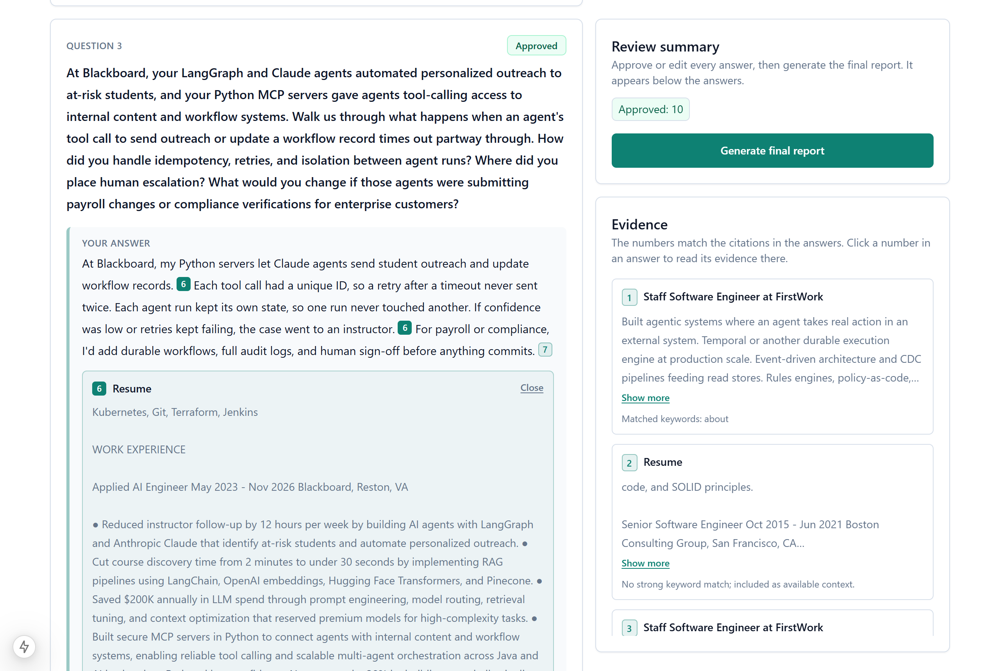

# Interview Ready AI

Interview Ready AI is a Claude-backed, agentic RAG application for interview preparation. You give it your resume and a job posting. It writes interview questions for that role and drafts an answer to each one from your own experience, citing the evidence it used. You review every answer, and the approved answers become a final prep report.

## Demo

From a resume and a job posting to reviewed answers and the final report:


## How It Works

### 1. Add your resume and the job

Upload a PDF or text resume, or paste its text. For the job, paste the posting URL, or paste the description itself for sites that block automated access. While the analysis runs, a progress bar shows each step: reading the resume and the job, pulling company details out of the posting, writing the questions, then drafting answers. If the job page can't be read (blocked, or behind a login), the analysis stops right away and asks you to paste the description instead.

You get 10 questions: two standard openers ("Tell me about yourself", "Why are you interested in this role?"), seven questions tailored to your resume and the job, and "What questions do you have for us?" to close.


### 2. Review each answer

Each question gets a first-person answer in plain English. The numbered badges are citations: click one to read the resume or job text it comes from, right under the answer. Guardrail notes flag claims the evidence doesn't back up. For each answer you can **Approve** it, **Edit** it yourself, or **Request revision** with a note, and Claude rewrites it. **Approve all** approves every answer still waiting for review. The review summary and evidence list stay beside the answers as you scroll.



### 3. Generate the final report

Once every answer is approved or edited, **Generate final report** builds a prep report below the answers: a company and role overview, your background, every question with its full approved answer (word for word, not summarized), coaching tips, questions to ask, and risks to prepare for. If you change an answer afterwards, the next report is rebuilt from the updated answers.


## Tech Stack

- Backend: Python, FastAPI
- Orchestration: an async analysis pipeline (scrape, parse, research, index, generate, draft, check)
- LLM provider: Claude via the Anthropic Python SDK
- Retrieval: local keyword index stored as JSON files
- Frontend: Next.js, React, TypeScript
- Styling: Tailwind CSS, with lucide-react icons
- Report rendering: react-markdown

## Project Structure

```text
backend/   FastAPI API, analysis pipeline, RAG and guardrail services, and storage adapters
frontend/  Next.js app shell and interview-prep UI components
docs/      Demo recording and README screenshots
```

See [backend/README.md](backend/README.md) for the API endpoints and [frontend/README.md](frontend/README.md) for the UI code layout.

## Local Setup

### Backend

```bash
cd backend
uv sync
cp .env.example .env
uv run uvicorn app.main:app --reload
```

Dependencies are managed with [uv](https://docs.astral.sh/uv/). `uv sync` creates `backend/.venv` with the Python version in `.python-version` and the exact package versions in `uv.lock`.

The backend runs at `http://localhost:8000` by default.

Set `ANTHROPIC_API_KEY` in `backend/.env` before using LLM generation. Create the key in the Claude Console; a claude.ai subscription does not include API access. `CLAUDE_MODEL` selects the model and defaults to `claude-opus-5-5`.

Note: Retrieval and session persistence are local, file-based services. LLM generation uses the Claude API.

### Frontend

```bash
cd frontend
npm install
cp .env.example .env.local
npm run dev
```

The frontend runs at `http://localhost:3000` by default. It calls the API at `NEXT_PUBLIC_API_BASE_URL` (`http://localhost:8000/api` by default), and the backend only accepts requests from the origins in `ALLOWED_ORIGINS`, so update that if you run the frontend on another port.

### Tests

```bash
cd backend
uv run pytest
```

The tests run offline: web fetches and Claude calls are replaced by fakes. For the frontend, `npx tsc --noEmit` type-checks the code.
